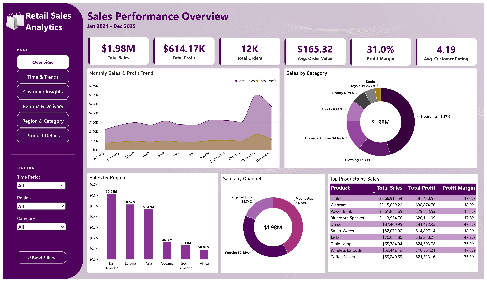
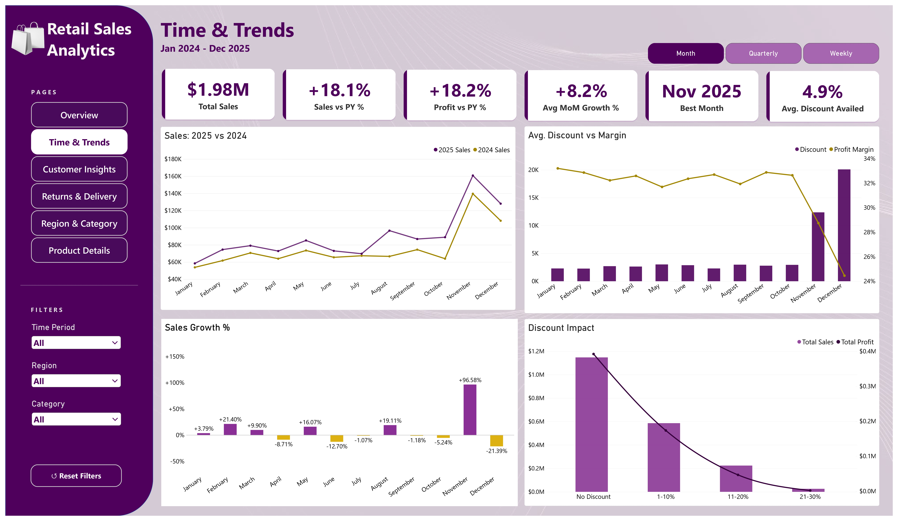
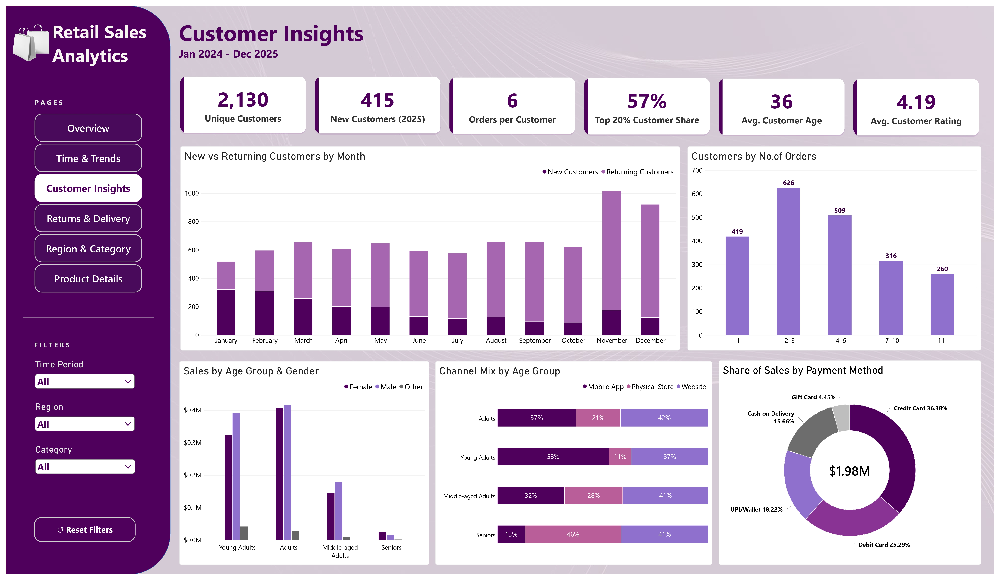
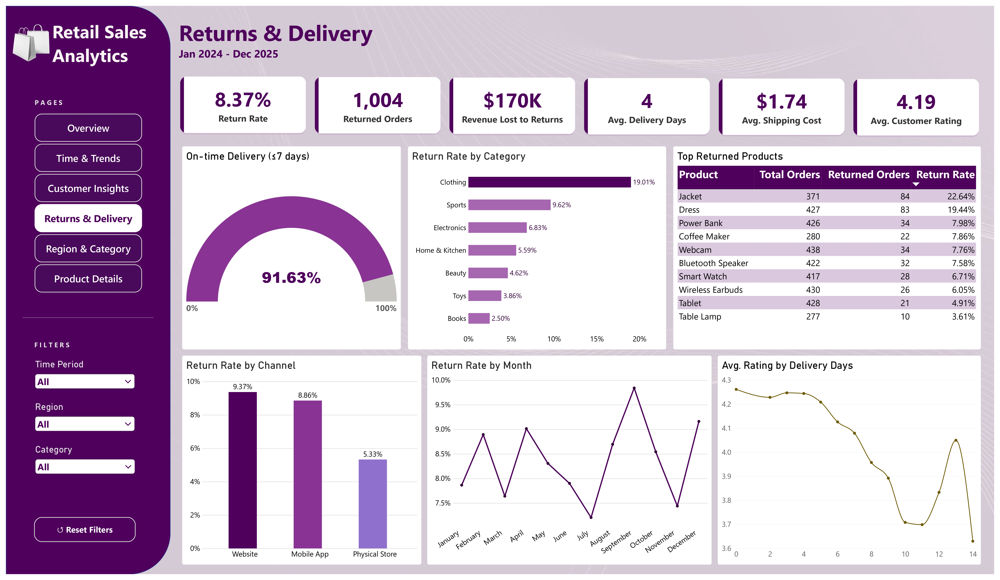
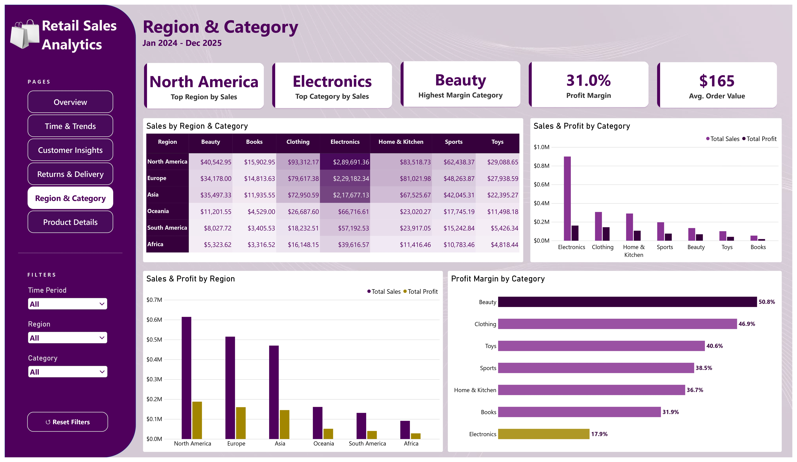
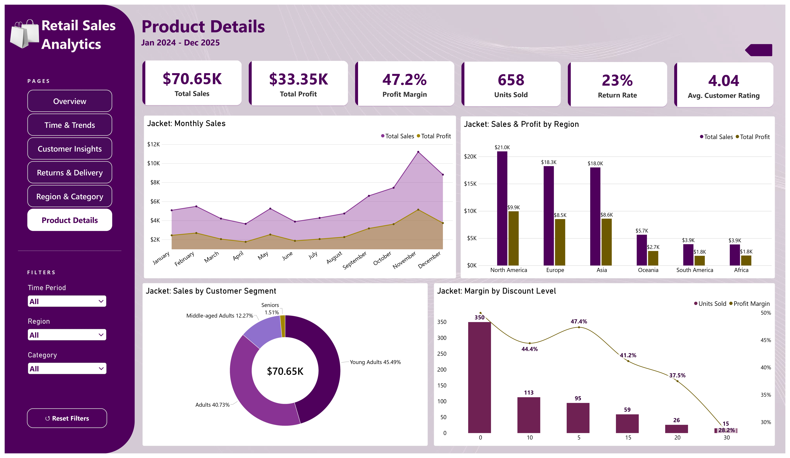

# Retail Sales Performance Dashboard (Power BI)

An interactive, 6-page Power BI report analysing **12,000 retail orders (Jan 2024 – Dec 2025)** across regions, product categories, sales channels, customers, returns and discounts. It answers the questions a business team asks every day: What are we selling? Where? To whom? Through which channel? And is it actually profitable?

🌱 This was my very first Power BI dashboard, built during my Power BI learning journey and then redesigned into a multi-page report. If you're a learner looking for a comfortable, beginner-friendly dataset to start building dashboards, this is a great one to begin with.

---

## Dashboard Preview

### 1. Overview

### 2. Time & Trends

### 3. Customer Insights

### 4. Returns & Delivery

### 5. Region & Category

### 6. Product Details (drill-through)

📄 A PDF export of the full report is also included: [Retail_Sales_Dashboard.pdf](Dashboard/Retail_Sales_Dashboard.pdf)

---

## Key Metrics at a Glance

| KPI | Value |
|---|---|
| Total Sales | **$1.98M** |
| Total Profit | **$614.17K** |
| Profit Margin | **31.0%** |
| Total Orders | **12K** |
| Avg. Order Value | **$165.32** |
| Unique Customers | **2,130** |
| Sales Growth (2025 vs 2024) | **+18.1%** |
| Return Rate | **8.37%** |
| Avg. Customer Rating | **4.19 / 5** |

---

## Report Pages

| Page | What it answers | Main visuals |
|---|---|---|
| **Overview** | How is the business doing overall? | KPI cards, monthly sales & profit trend, sales by category, region and channel, top products |
| **Time & Trends** | How do sales change over time, and what do discounts do? | 2025 vs 2024 sales, avg. discount vs margin, monthly sales growth %, discount impact; Month / Quarter / Week toggle |
| **Customer Insights** | Who are our customers and how do they buy? | New vs returning customers, customers by number of orders, sales by age & gender, channel mix by age, payment methods |
| **Returns & Delivery** | What gets returned, and does delivery speed matter? | On-time delivery gauge, return rate by category / channel / month, top returned products, rating by delivery days |
| **Region & Category** | Where and what drives sales and profit? | Region × category sales heatmap, sales & profit by category and region, profit margin by category |
| **Product Details** | How is one product performing? | Drill-through page: product KPIs, monthly trend, sales & profit by region, customer segments, margin by discount level |

### Interactive features
- **Side navigation panel** with page buttons and synced slicers (Time Period, Region, Category)
- **Reset Filters** button (bookmark-based) that clears slicers *and* chart selections
- **Drill-through:** right-click any product → *Drill through → Product Details*
- **Dynamic titles** that update with the selected product (e.g. *"Jacket: Monthly Sales"*)
- **Field-parameter toggle** to switch the time view between Month, Quarter and Week
- **Conditional formatting** to highlight the best and worst values (e.g. negative growth, lowest margin)

---

## Key Insights

**Sales & profitability**
- **Electronics drives 45% of sales but has the lowest margin (17.9%).** Beauty (50.8%) and Clothing (46.9%) earn far more per dollar.
- **2025 grew strongly:** sales +18.1% and profit +18.2% vs 2024.
- **Nov–Dec is the peak season**, bringing in about 27% of yearly sales.
- **Holiday discounts hurt margin:** average discount jumps to ~13% in December and profit margin falls from ~33% to ~24%.
- **Bigger discounts don't sell more units.** Margin drops steadily as the discount level rises; for some products (e.g. Tablet) a 30% discount makes the order loss-making.

**Customers**
- **Growth now comes from repeat buyers:** new customers fell from 1,715 in 2024 to 415 in 2025.
- **The top 20% of customers bring in 57% of sales.**
- 419 customers (20%) have ordered only once.
- Young adults prefer the **mobile app**, while seniors prefer **physical stores**.

**Returns & delivery**
- **Clothing has a 19% return rate**, about 2× any other category. Jacket (22.6%) and Dress (19.4%) are the most-returned products, despite ~47% margins.
- **Returns cost about $170K** in lost revenue (1,004 returned orders).
- Online orders are returned more often (~9%) than in-store purchases (5.3%).
- **Customer rating drops when delivery takes longer than 7 days.**

**Regions**
- North America is the top region ($0.61M), followed by Europe ($0.52M) and Asia ($0.47M); together they make up 81% of sales.
- Profit margin depends on **category, not region**: each category's margin is almost the same in every region.

---

## Data Model & DAX

- **Fact table:** one flat sales table (12,000 rows, 20 columns)
- **Date table** built in DAX (`CALENDAR`) and marked as a date table, with Year, Month, Quarter, Year-Month and Week Start columns
- **Disconnected helper tables** for the Product Details page (product list and a metrics table) so comparisons ignore the drill-through filter

Example measures used in the report:

| Area | Measures |
|---|---|
| Core | Total Sales, Total Profit, Profit Margin %, Orders, Avg. Order Value, Units Sold |
| Time intelligence | Sales vs PY %, Profit vs PY %, YoY Sales Growth %, period-over-period growth (Month / Quarter / Week), Best Month |
| Customers | Customers, New Customers, Returning Customers, Orders per Customer, Top 20% Customer Share |
| Returns & delivery | Returned Orders, Return Rate, Revenue Lost to Returns, On-time Delivery % |
| Presentation | Dynamic chart titles and subtitles, colour measures for conditional formatting |

Calculated columns include **Customer Type** (New / Returning), **Order Bucket** (1, 2–3, 4–6, 7–10, 11+ orders), **Discount Band** and sort-order columns.

---

## Repository Contents

| File | Location | Description |
|---|---|---|
| `Retail_Sales_Dashboard.pbix` | `Dashboard/` | Power BI Desktop project file (open this to explore and edit) |
| `Retail_Sales_Dashboard.pdf` | `Dashboard/` | PDF export of all report pages |
| `Retail_Sales_Dashboard_page-000X.jpg` | `Dashboard/` | Page screenshots used in this README |
| `retail_sales_dataset.csv` | `Data/raw/` | Raw dataset (CSV) |
| `retail_sales_dataset.xlsx` | `Data/cleaned/` | Cleaned dataset (Excel), with an added `customer_age_group` column |
| `canvas-bg.jpg`, `shopper.png` | `images/` | Background and logo assets used in the report |

---

## Dataset Overview

- **Rows:** 12,000 orders
- **Columns:** 19 (raw) / 20 (cleaned, with `customer_age_group`)
- **Period:** January 2024 – December 2025 (2 years of daily orders)
- **Regions:** Africa, Asia, Europe, North America, Oceania, South America
- **Categories:** Beauty, Books, Clothing, Electronics, Home & Kitchen, Sports, Toys
- **Products:** 42 unique products
- **Customers:** 2,130 unique customers

| Column | Description |
|---|---|
| `order_id` | Unique order identifier |
| `order_date` | Date the order was placed |
| `customer_id` | Customer identifier |
| `customer_age` | Customer age |
| `gender` | Male / Female / Other |
| `region` | Customer region |
| `product_category` | Product category |
| `product_name` | Product name |
| `unit_price` | Price per unit |
| `quantity` | Units ordered |
| `discount_pct` | Discount applied (%) |
| `order_channel` | Website / Mobile App / Physical Store |
| `payment_method` | Credit Card, Debit Card, UPI/Wallet, Cash on Delivery, Gift Card |
| `shipping_cost` | Shipping charge |
| `delivery_days` | Days taken to deliver (0 for in-store purchases) |
| `returned` | Whether the order was returned (Yes/No) |
| `customer_rating` | Rating given (1–5; blank if not rated) |
| `total_amount` | Final order amount (sales) |
| `profit` | Profit on the order |
| `customer_age_group` | Young Adults (18–31), Adults (32–45), Middle-aged Adults (46–59), Seniors (60+) — cleaned file only |

---

## Tools & Skills Used

- **Python (Pandas)**: data cleaning, manipulation and exploratory data analysis
- **Power Query**: data transformation and preparation
- **Power BI Desktop**: multi-page interactive report
- **DAX**: measures, time intelligence, calculated columns and tables, dynamic titles
- **Data modelling**: date table, disconnected tables, sort-by columns
- **Report design**: side navigation, synced slicers, bookmarks, drill-through, field parameters, conditional formatting and a consistent colour theme

---

## Learn With This Project

New to Power BI? This dataset is a comfortable place to start because it is:

- **Clean and well-structured**: one flat table, no complex joins needed
- **Rich enough to be interesting**: dates, geography, categories, channels, discounts, returns, ratings and profit
- **Realistic business context**: the kind of questions you'll see in real analyst work
- **Small enough to stay fast**: 12K rows load instantly

**Practice ideas, roughly from beginner to advanced:**

1. Rebuild the **Overview** page: KPI cards, a trend line and category/region charts
2. Create a **date table** and try time-intelligence DAX (YoY, MoM, YTD)
3. Analyse **return rates** by category, product and channel
4. Explore **delivery days vs. customer rating**
5. Segment customers into **new vs returning** and by **number of orders**
6. Add a **drill-through page** with dynamic titles
7. Use **bookmarks**, **field parameters** and **conditional formatting** to make the report interactive

Feel free to fork this repo, reuse the dataset and build your own version.

---

## Future Improvements

- Add a **Key Insights** page with findings and recommendations
- Report-page **tooltips** for richer hover details
- **Forecasting** of monthly sales
- **Mobile layout** for phone viewing
- Publish to **Power BI Service** with scheduled refresh
